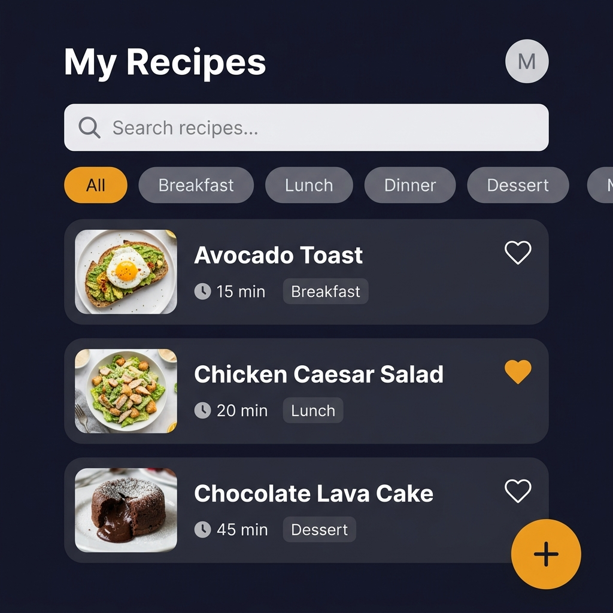
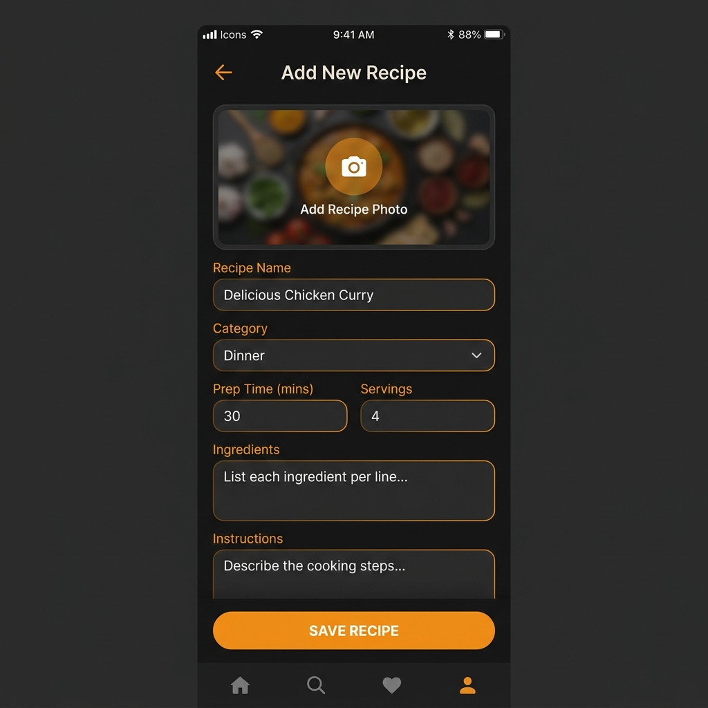

# 🍽️ My Recipe Book — Mobile App

## Short Description

**My Recipe Book** is a mobile app designed for food lovers who want a simple and beautiful way to store, organize, and revisit their favorite recipes — whether they found them online, inherited them from family, or invented them in their own kitchen. Instead of hunting through browser bookmarks or stacks of handwritten notes, users can keep all their recipes in one place, neatly organized and always accessible — even without an internet connection. The app allows users to add recipes with photos, step-by-step instructions, and key details like cooking time and number of servings, making meal planning easier and more enjoyable for everyday home cooks. Whether you are preparing a dinner party or just figuring out tonight's meal, My Recipe Book puts your entire culinary collection at your fingertips.

---

## 📦 Domain Details — The Recipe Entity

Each recipe saved in the app is stored as a structured record. Below is a description of every piece of information that is saved for each recipe:

| Field | Description |
|---|---|
| **Recipe Name** | The title of the recipe (e.g., "Grandma's Chocolate Cake"). This is the main identifier shown in lists and searches. |
| **Category** | The meal type this recipe belongs to — for example: Breakfast, Lunch, Dinner, Dessert, or Snack. Used for filtering and organization. |
| **Prep Time (minutes)** | How many minutes it takes to prepare and cook this recipe from start to finish. Helps users plan their meals. |
| **Servings** | The number of people this recipe feeds (e.g., 4 people). Useful for scaling ingredients up or down. |
| **Ingredients** | A list of all the ingredients needed, with their quantities (e.g., "2 cups of flour, 3 eggs"). |
| **Instructions** | The step-by-step cooking directions the user follows to make the dish. |
| **Photo** | An optional image of the finished dish, taken from the phone's camera or gallery. Makes recipes easier to identify at a glance. |
| **Favorite** | A simple yes/no flag that marks a recipe as a personal favorite, so users can quickly access their most-loved meals. |
| **Date Added** | The date the recipe was first saved to the app. Used to sort recipes by newest or oldest. |

---

## 🔄 CRUD Operations

CRUD stands for **Create, Read, Update, and Delete** — the four core things a user can do with their recipes in the app.

### ➕ Create — Adding a New Recipe
When a user wants to save a new recipe, they tap the **"+" button** on the main screen. A form opens where they can fill in the recipe name, choose a category, enter the prep time, number of servings, list the ingredients, write the cooking instructions, and optionally attach a photo from their camera or gallery. Once they tap **"Save"**, the recipe is stored in the app and appears in their recipe list immediately.

### 👁️ Read — Viewing Recipes
Users can browse all their saved recipes from the home screen, which displays a scrollable list of recipe cards showing the photo, name, category, and prep time at a glance. They can also use the **search bar** to find a recipe by name or filter by category (e.g., show only Desserts). Tapping on a recipe card opens the full details page, showing all ingredients and instructions in a clean, easy-to-read layout.

### ✏️ Update — Editing an Existing Recipe
If a user wants to change something in a saved recipe — for example, updating the number of servings or fixing a typo in the instructions — they can open the recipe and tap the **"Edit" button**. The same form used for creating a recipe opens, pre-filled with the current information. After making changes, the user taps **"Save"** to apply the updates.

### 🗑️ Delete — Removing a Recipe
If a user no longer wants a recipe, they can delete it by swiping left on the recipe card in the list or tapping the **"Delete" button** on the recipe detail page. A confirmation prompt will appear asking "Are you sure you want to delete this recipe?" to prevent accidental deletions. Once confirmed, the recipe is permanently removed from the app.

---

## 💾 Persistence Details — Where Data is Saved

The app saves data in two places: **locally on the device** (so it works without internet) and **on a remote server** (so data is backed up and accessible from multiple devices).

| CRUD Operation | Saved Locally on Device | Saved on Remote Server |
|---|---|---|
| **Create** (add a recipe) | ✅ Yes — immediately saved on the device | ✅ Yes — synced to the server in the background |
| **Read** (view recipes) | ✅ Yes — recipes are loaded from local storage for speed | ✅ Yes — server is checked for updates when online |
| **Update** (edit a recipe) | ✅ Yes — changes are saved locally first | ✅ Yes — updated data is sent to the server when online |
| **Delete** (remove a recipe) | ✅ Yes — recipe is removed from local storage immediately | ✅ Yes — deletion is synced to the server when online |
| **Favorite toggle** | ✅ Yes — favorite status stored locally | ✅ Yes — synced to the server |

---

## 📵 Offline Behavior — Using the App Without Internet

The app is designed to be **fully functional even when the device has no internet connection**. Here is how each operation behaves offline:

### ➕ Create (Offline)
If a user adds a new recipe while offline, the recipe is saved **directly to the device's local storage** and becomes immediately visible in the recipe list. The app marks it internally as "pending sync." As soon as the device reconnects to the internet, the app automatically uploads the new recipe to the server in the background — no action required from the user.

### 👁️ Read (Offline)
All previously loaded recipes are available offline because they are stored on the device. The user can browse, search, filter, and view the full details of any recipe they have already seen or added — exactly as if they were online. They simply cannot receive new recipes from other devices until the connection is restored.

### ✏️ Update (Offline)
If a user edits a recipe while offline, the changes are saved locally on the device and the updated version is shown immediately. The app queues the update and automatically syncs it to the server once internet access is available again. If a conflict occurs (e.g., the same recipe was also edited on another device), the most recently edited version is kept.

### 🗑️ Delete (Offline)
If a user deletes a recipe while offline, it is removed from the local device immediately and disappears from the recipe list. The delete action is queued and sent to the server the next time the app goes online, ensuring the recipe is also removed from the server and any other synced devices.

---

## 📱 App Mockups

Below are screen captures of the app's main screens to illustrate the look and feel of the user interface.

### Screen 1 — Recipe List (Home Screen)
The main screen users see when they open the app. It shows all saved recipes in a searchable, filterable list.

---

### Screen 2 — Add / Edit Recipe Screen
The form users fill in to add a new recipe or edit an existing one.

